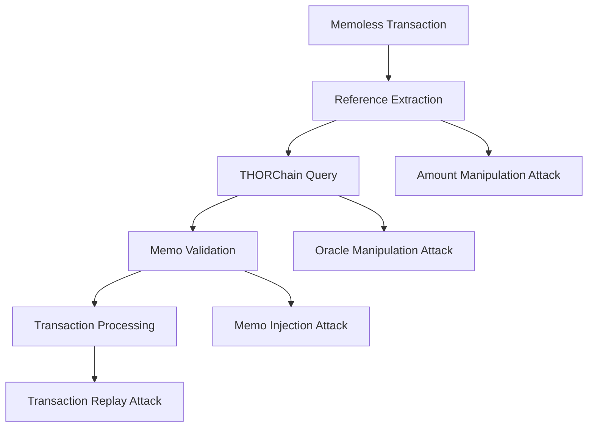

# Bifrost Memoless Protocol Testing Plan

## Executive Summary

This document outlines a comprehensive testing strategy for the Bifrost Memoless Protocol that addresses the unique challenges of blockchain environments, Byzantine Fault Tolerance (BFT) consensus mechanisms, and sophisticated edge cases that arise in distributed systems.

Unlike traditional software testing, blockchain systems require validation against adversarial conditions, network partitions, consensus failures, and cryptographic attacks that are inherent to decentralized environments.

---

## 1. Blockchain-Specific Testing Categories

### 1.1 Consensus Layer Testing

#### **BFT Consensus Scenarios**

- **Leader Election Failures**: Test memoless processing during validator set changes
- **Network Partitions**: Validate memo resolution with isolated validator subsets
- **Byzantine Validators**: Test with up to 1/3 malicious validators providing false memo data
- **Consensus Timeout Scenarios**: Handle memo lookups during consensus delays
- **Fork Resolution**: Test memo consistency across competing blockchain forks

#### **Block Production Edge Cases**

- **Empty Blocks**: Ensure memo expiry calculations work with missing blocks
- **Large Block Gaps**: Test with significant time jumps between blocks
- **Block Reorganizations**: Validate memo consistency during chain reorgs
- **Genesis Block Edge Cases**: Test memo processing from network inception
- **Checkpoint/Snapshot Recovery**: Validate memo state after node restarts

### 1.2 Network Layer Testing

#### **P2P Network Attacks**

- **Eclipse Attacks**: Test memo resolution with manipulated peer connections
- **Sybil Attacks**: Validate against fake nodes providing incorrect memo data
- **Message Flooding**: Test system stability under memo query spam
- **Network Isolation**: Handle partial connectivity to THORChain nodes
- **Latency Attacks**: Test with artificially delayed memo responses

#### **Cross-Chain Communication**

- **Bridge Failures**: Test when cross-chain communication is disrupted
- **Oracle Manipulation**: Validate against false cross-chain data feeds
- **Chain Halt Scenarios**: Handle memo processing when external chains halt
- **Rollback Attacks**: Test consistency when external chains reorganize
- **Multi-Chain Coordination**: Validate memo consistency across multiple chains

---

## 2. Fuzzing and Property-Based Testing

### 2.1 Memoless Protocol Fuzzing

#### **Reference Code Fuzzing**

```rust
// Property: All valid 5-digit references should extract correctly
property_extract_reference(amount: u64) {
    if has_valid_reference_pattern(amount) {
        let ref = extract_reference(amount);
        assert!(ref.len() == 5);
        assert!(ref.chars().all(|c| c.is_numeric()));
    }
}
```

**Fuzzing Targets:**

- **Amount Range Testing**: Test with u64::MAX, 0, and overflow conditions
- **Reference Pattern Edge Cases**: Test 00000, 99999, invalid patterns
- **Unicode Reference Injection**: Test with non-ASCII numeric characters
- **Encoding Boundary Conditions**: Test reference encoding at bit boundaries
- **Mathematical Overflow**: Test amount calculations near integer limits

#### **Memo Content Fuzzing**

- **Malformed Memo Strings**: Invalid UTF-8, control characters, null bytes
- **Extremely Long Memos**: Test with memos exceeding blockchain limits
- **Memo Injection Attacks**: Test with embedded commands or scripts
- **Binary Data Injection**: Test with raw binary data as memo content
- **Encoding Exploits**: Test with various text encoding edge cases

### 2.2 State Machine Property Testing

#### **Invariant Properties**

```go
// Property: Memo registration should be idempotent
property_memo_registration_idempotent(memo RegisteredMemo) {
    state1 := store_memo(memo)
    state2 := store_memo(memo)
    assert_eq(state1, state2)
}

// Property: Reference extraction should be reversible
property_reference_reversible(base_amount u64, reference string) {
    encoded := encode_amount_with_reference(base_amount, reference)
    extracted := extract_reference(encoded)
    adjusted := adjust_amount(encoded, reference)

    assert_eq(extracted, reference)
    assert_eq(adjusted, base_amount)
}
```

#### **State Consistency Properties**

- **Memo Expiry Monotonicity**: Expired memos stay expired
- **Reference Uniqueness**: No two active memos share references
- **Transaction Atomicity**: Failed memo resolution doesn't corrupt state
- **Height Consistency**: Block heights always increase for valid chains
- **Storage Invariants**: Database constraints maintained across operations

---

## 3. Adversarial Testing Scenarios

### 3.1 Economic Attack Vectors

#### **MEV and Front-Running**

- **Memo Sniping**: Test against attackers monitoring memo registrations
- **Reference Collision Attacks**: Attempt to register conflicting references
- **Expiry Racing**: Test attacks based on memo expiry timing
- **Fee Market Manipulation**: Test memo processing under extreme fee conditions
- **Liquidity Attacks**: Test with artificial scarcity of memo references

#### **Griefing Attacks**

- **Reference Space Exhaustion**: Register maximum number of references
- **Storage Spam**: Register many short-lived memos to consume storage
- **Computation Attacks**: Submit expensive memo validation operations
- **Network Resource Attacks**: Flood network with memo queries
- **Validator Resource Attacks**: Target specific validators with memo load

### 3.2 Cryptographic Attack Scenarios

#### **Hash and Signature Attacks**

- **Hash Collision Attempts**: Test with crafted reference hash collisions
- **Signature Malleability**: Test with modified but valid signatures
- **Key Recovery Attacks**: Test against attempts to derive private keys
- **Replay Attacks**: Resubmit old memo registration transactions
- **Time-Based Attacks**: Exploit timing differences in memo validation

#### **Data Integrity Attacks**

- **Bit-Flip Attacks**: Test with corrupted memo data
- **Truncation Attacks**: Test with partially transmitted memo data
- **Padding Oracle Attacks**: Test encrypted memo storage scenarios
- **Side-Channel Analysis**: Test for timing-based information leakage
- **Fault Injection**: Test with simulated hardware faults

---

## 4. Byzantine Fault Tolerance Testing

### 4.1 Byzantine Validator Behavior

#### **Malicious Validator Scenarios**

```yaml
byzantine_test_scenarios:
  - name: "memo_data_manipulation"
    description: "1/3 validators return incorrect memo content"
    byzantine_fraction: 0.33
    attack_vector: "false_memo_content"

  - name: "selective_memo_censorship"
    description: "Byzantine validators ignore specific references"
    byzantine_fraction: 0.25
    attack_vector: "reference_filtering"

  - name: "timing_manipulation"
    description: "Delay memo responses to cause timeouts"
    byzantine_fraction: 0.20
    attack_vector: "response_delay"
```

#### **Consensus Split Scenarios**

- **Competing Memo Versions**: Different validator subsets return different memos
- **Partial Network Availability**: Some validators unreachable during memo lookup
- **Historical Data Corruption**: Byzantine validators corrupt past memo data
- **State Machine Divergence**: Validators have inconsistent memo state
- **Finality Violations**: Test memo consistency before/after finality

### 4.2 Network Partition Testing

#### **CAP Theorem Scenarios**

- **Consistency vs Availability**: Test memo service during network splits
- **Partition Tolerance**: Validate memo processing with isolated nodes
- **Split-Brain Scenarios**: Handle multiple validator groups claiming leadership
- **Healing After Partition**: Test memo consistency after network reunification
- **Cascading Failures**: Test when network partitions cause validator failures

---

## 5. Performance and Scalability Testing

### 5.1 Load Testing Scenarios

#### **High-Throughput Testing**

```go
load_test_scenarios := []LoadTest{
    {
        name: "memo_registration_burst",
        tps: 10000,
        duration: "10m",
        operation: "register_memo",
    },
    {
        name: "memo_lookup_storm",
        tps: 50000,
        duration: "5m",
        operation: "lookup_memo",
    },
    {
        name: "concurrent_observers",
        observers: 100,
        txs_per_observer: 1000,
        operation: "process_memoless_tx",
    },
}
```

#### **Resource Exhaustion Testing**

- **Memory Pressure**: Test with maximum memo storage utilization
- **CPU Saturation**: Test memo processing under high computational load
- **Network Bandwidth**: Test with saturated network connections
- **Disk I/O Limits**: Test memo persistence under storage constraints
- **File Descriptor Limits**: Test with maximum concurrent connections

### 5.2 Scalability Edge Cases

#### **State Growth Scenarios**

- **Maximum Memo Count**: Test with theoretical maximum registered memos
- **Long-Running Networks**: Test memo processing after years of operation
- **Historical Query Load**: Test access to old memo data under load
- **State Pruning**: Test memo availability during state pruning operations
- **Backup/Recovery**: Test memo consistency during backup operations

---

## 6. Integration Testing with External Systems

### 6.1 Cross-Chain Integration

#### **Multi-Chain Memoless Scenarios**

- **Chain-Specific References**: Test reference conflicts across chains
- **Cross-Chain Memo Consistency**: Validate memo data across bridge operations
- **Chain Halt Propagation**: Test memo processing when external chains halt
- **Bridge Security**: Test memo integrity across chain bridges
- **Multi-Asset Scenarios**: Test with various asset types and chains

#### **External Oracle Integration**

- **Oracle Failure Scenarios**: Test when price/data oracles fail
- **Oracle Data Manipulation**: Test against false oracle data
- **Oracle Network Partitions**: Handle isolated oracle networks
- **Oracle Consensus Failures**: Test with competing oracle data
- **Oracle Recovery**: Test system recovery after oracle failures

### 6.2 Wallet Integration Testing

#### **Wallet Compatibility Edge Cases**

- **Wallet State Desynchronization**: Test with outdated wallet state
- **Transaction Broadcasting Failures**: Handle failed memo transactions
- **Wallet Network Switching**: Test memo consistency across networks
- **Hardware Wallet Edge Cases**: Test with hardware wallet limitations
- **Mobile Wallet Constraints**: Test with mobile network conditions

---

## 7. Chaos Engineering and Disaster Recovery

### 7.1 Chaos Engineering Scenarios

#### **Infrastructure Chaos**

```yaml
chaos_experiments:
  - name: "random_node_failures"
    description: "Randomly kill observer nodes during memo processing"
    failure_rate: "10%"
    duration: "1h"

  - name: "network_latency_injection"
    description: "Add random latency to memo API calls"
    latency_range: "100ms-10s"
    affected_percentage: "30%"

  - name: "disk_corruption_simulation"
    description: "Simulate disk failures during memo storage"
    corruption_rate: "0.1%"
    recovery_test: true
```

#### **Service Degradation Testing**

- **Partial Service Outages**: Test with some memo services unavailable
- **Cascading Failure Recovery**: Test recovery from multiple simultaneous failures
- **Dependency Failure Isolation**: Isolate failures in external dependencies
- **Circuit Breaker Validation**: Test circuit breaker behavior under various failure modes
- **Graceful Degradation**: Test system behavior with reduced functionality

### 7.2 Disaster Recovery Testing

#### **Data Recovery Scenarios**

- **State Snapshot Recovery**: Test memo state recovery from snapshots
- **Transaction Log Replay**: Recover memo state from transaction logs
- **Cross-Node State Sync**: Synchronize memo state across recovered nodes
- **Partial Data Loss**: Handle scenarios with incomplete memo data
- **Byzantine Recovery**: Recover from Byzantine failures in storage

---

## 8. Security Testing Framework

### 8.1 Threat Model Validation

#### **Attack Surface Analysis**



#### **Vulnerability Assessment**

- **Input Validation Bypasses**: Test all input validation mechanisms
- **Authorization Bypass**: Test access control around memo operations
- **Information Disclosure**: Test for sensitive information leakage
- **Denial of Service**: Test system resilience against DoS attacks
- **Code Injection**: Test for various injection attack vectors

### 8.2 Penetration Testing Scenarios

#### **Red Team Exercises**

- **Coordinated Multi-Vector Attacks**: Combined technical and social attacks
- **Insider Threat Simulation**: Test against malicious insider scenarios
- **Supply Chain Attacks**: Test against compromised dependencies
- **Zero-Day Exploitation**: Simulate attacks on unknown vulnerabilities
- **Advanced Persistent Threats**: Long-term compromise scenarios

---

## 9. Regulatory and Compliance Testing

### 9.1 Data Privacy Testing

#### **Privacy-Preserving Properties**

- **Memo Content Privacy**: Ensure memo content isn't leaked inappropriately
- **Transaction Graph Analysis**: Test resistance to transaction analysis
- **Timing Analysis**: Test resistance to timing-based user identification
- **Metadata Leakage**: Validate minimal metadata exposure
- **Cross-Chain Privacy**: Maintain privacy across chain interactions

### 9.2 Audit Trail Testing

#### **Auditability Requirements**

- **Transaction Traceability**: Maintain complete audit trails
- **Memo Provenance**: Track memo creation and modification history
- **Validator Accountability**: Audit validator behavior with memo operations
- **Compliance Reporting**: Generate required regulatory reports
- **Forensic Analysis**: Support post-incident investigation

---

## 10. Testing Infrastructure and Automation

### 10.1 Automated Test Execution

#### **Continuous Testing Pipeline**

```yaml
testing_pipeline:
  stages:
    - unit_tests:
        parallel: true
        timeout: "10m"
    - integration_tests:
        parallel: false
        timeout: "30m"
    - chaos_tests:
        parallel: true
        timeout: "2h"
    - security_tests:
        parallel: false
        timeout: "4h"

  triggers:
    - pull_request
    - nightly_build
    - release_candidate
```

#### **Test Environment Management**

- **Multi-Network Testing**: Automated deployment across test networks
- **State Management**: Automated setup/teardown of test scenarios
- **Data Generation**: Automated generation of test data and scenarios
- **Result Analysis**: Automated analysis and reporting of test results
- **Regression Detection**: Automated detection of performance regressions

### 10.2 Monitoring and Observability

#### **Test Observability Stack**

- **Metrics Collection**: Comprehensive metrics on memo processing performance
- **Distributed Tracing**: End-to-end tracing of memo resolution flows
- **Alerting Systems**: Automated alerts on test failures or anomalies
- **Dashboard Visualization**: Real-time visibility into system health
- **Log Aggregation**: Centralized logging for debugging and analysis

---

## 11. Test Implementation Priorities

### Phase 1: Foundation (Week 1-2)

1. **Property-based fuzzing framework** for reference extraction
2. **Basic BFT consensus testing** with simulated Byzantine validators
3. **Load testing infrastructure** with automated scenario execution
4. **Security testing baseline** with common attack vectors

### Phase 2: Advanced Scenarios (Week 3-4)

1. **Chaos engineering framework** with controlled failure injection
2. **Cross-chain integration testing** with multiple blockchain networks
3. **Advanced adversarial testing** with economic attack simulations
4. **Performance regression testing** with automated benchmarking

### Phase 3: Production Readiness (Week 5-6)

1. **Full disaster recovery testing** with complete system recovery
2. **Regulatory compliance validation** with audit trail verification
3. **Red team penetration testing** with coordinated attack scenarios
4. **Production monitoring setup** with comprehensive observability

---

## 12. Success Criteria and Metrics

### Functional Correctness Metrics

- **Zero false positives**: No valid transactions incorrectly rejected
- **Zero false negatives**: No invalid transactions incorrectly accepted
- **100% state consistency**: All nodes maintain identical memo state
- **Sub-second memo resolution**: Memo lookups complete within 1 second
- **99.9% availability**: Memo service availability under normal conditions

### Security Assurance Metrics

- **Zero critical vulnerabilities**: No exploitable security issues discovered
- **Resistance to 33% Byzantine**: System functions with up to 1/3 malicious validators
- **Attack surface minimization**: Minimal exposed attack vectors
- **Complete audit trails**: All operations fully traceable and auditable
- **Privacy preservation**: No unintended information disclosure

### Performance and Scalability Metrics

- **10K TPS memo processing**: Handle 10,000 memoless transactions per second
- **Linear scaling**: Performance scales linearly with additional validators
- **Sub-100ms latency**: 99th percentile memo processing under 100ms
- **Minimal resource usage**: Efficient CPU, memory, and network utilization
- **Graceful degradation**: Maintain core functionality under partial failures

---

## Conclusion

This comprehensive testing plan addresses the unique challenges of blockchain and BFT systems by focusing on adversarial conditions, Byzantine fault tolerance, and sophisticated attack scenarios that are absent from traditional software testing.

The plan prioritizes **security**, **correctness**, and **resilience** over simple functional testing, ensuring that the Memoless Protocol can operate safely in the hostile environment of public blockchains where economic incentives drive sophisticated attacks.

**Implementation of this testing plan will provide high confidence that the Memoless Protocol is production-ready for deployment on THORChain's mainnet.**
