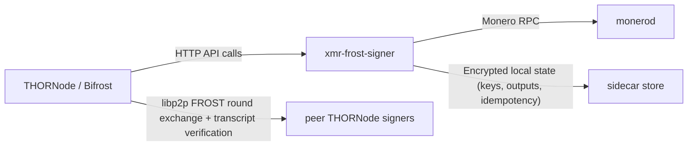

# XMR Integration Design (THORNode + Sidecar)

## Goal
This document explains how the XMR integration works in THORNode, with emphasis on the boundary between THORNode/Bifrost and the `xmr-frost-signer` sidecar, and why responsibilities are split the way they are.

## Components
- THORNode core: chain state, vault/churn policy, outbound scheduling, observation consensus.
- Bifrost Monero chain client: THORNode adapter for XMR (`bifrost/pkg/chainclients/monero`).
- go-tss FROST coordinator: peer coordination over libp2p (`bifrost/tss/go-tss/tss`).
- `xmr-frost-signer` sidecar: local Rust process for Monero/FROST cryptography, wallet scanning state, and daemon RPC.
- Monero daemon: canonical chain data and tx relay.

## Boundary: THORNode/Bifrost vs Sidecar

### Transport and trust boundary
- Boundary transport is HTTP between Bifrost and the sidecar endpoint on each node.
- Bifrost side (`FrostSigner`) enforces:
  - non-loopback endpoint must be HTTPS,
  - non-loopback endpoint must have auth (bearer or basic),
  - required endpoint config for XMR signer path.
- Sidecar requires configured auth at startup (bearer or basic) and enforces authenticated protected routes with per-IP/global rate limits.

### Boundary at a glance

### API contract at the boundary
Bifrost calls sidecar endpoints for:
- DKG: `/v1/monero/dkg/round1`, `/round2`, `/round3`, `/finalize`
- Signing: `/v1/monero/sign/prepare`, `/partial`, `/combine`
- Broadcast: `/v1/monero/broadcast`
- Scan/read: `/v1/monero/scanner/sync`, `/transfers`, `/balance/{vault}`, `/outputs/{vault}`, `/addresses/{vault}`, chain query endpoints
- No standalone vault registration endpoint; vault mapping is committed by DKG finalize.

The authoritative contract is in:
- `bifrost/pkg/chainclients/monero/XMR_TSS_SIGNER_API.md`

## Delegation Matrix
### THORNode/Bifrost/go-tss owns
- Vault membership + signer set from THORChain.
- FROST party formation (`joinParty`) and libp2p message exchange.
- Deterministic participant indexing and round transcript verification.
- Sender-to-peer binding checks and blame attribution.
- Deterministic `msg_id`, DKG context, plan hash/eventuality verification.
- Keygen gating:
  - all signers must be online for DKG,
  - derived address must match expected vault address,
  - sidecar finalize must succeed.
- Observation/attestation to THORChain:
  - observed txs,
  - errata handling,
  - solvency + network fee reporting.
- Reorg orchestration at block-scanner level.

### Sidecar owns
- FROST cryptographic state machines for local rounds (DKG and signing).
- Persistent encrypted key material and vault registry.
- Local tracked output state machine: unspent/reserved/spent.
- Output reservation lifecycle and reconciliation.
- Idempotency storage and replay handling for sign/broadcast endpoints.
- Deterministic decoy selection + Monero tx construction.
- Broadcast submission to monerod.
- Scanner state per vault and block-level output discovery.
- Direct daemon RPC calls and bounded response parsing.

### Intentionally split
- **Consensus/coordination in THORNode**, **private key material + chain-specific crypto in sidecar**.
- Sidecar never performs cross-peer consensus; it only executes local round math.
- THORNode never stores Monero threshold private key material.

## Keygen Flow (DKG)
1. THORNode signer triggers custom keygen hook for XMR after TSS keygen context is ready.
2. Bifrost calls `TssServer.FrostKeygen(...)` with signer set and expected XMR vault address.
3. go-tss:
   - forms party over libp2p,
   - requires full signer participation for DKG,
   - executes round exchange over p2p,
   - calls local sidecar each round for local cryptographic step.
4. Sidecar DKG:
   - round1: generate commitments,
   - round2: verify commitments and produce encrypted shares,
   - round3: derive group key + address, but only stages material.
5. go-tss validates cross-peer consistency and expected address.
6. go-tss calls sidecar `dkg/finalize`.
7. Sidecar finalize atomically registers vault mapping and persists encrypted threshold share.

Design choice:
- Finalization is explicit to avoid persisting key material before network-level agreement and address checks complete.

## Signing and Broadcast Flow
1. THORNode schedules outbound; Bifrost Monero client validates tx intent:
   - featured+guaranteed destination,
   - single XMR coin,
   - sufficient unlocked balance,
   - scanner freshness guard (sidecar rejects stale scan state).
2. Bifrost resolves current vault signer membership and calls `TssServer.FrostKeySign`.
3. go-tss:
   - derives deterministic `msg_id`,
   - runs preprocess/share exchanges over libp2p,
   - uses transcript verification + blame on inconsistencies.
4. Sidecar signing:
   - `prepare`: load key share, build unsigned tx, select decoys deterministically, reserve chosen inputs,
   - `partial`: create local signature share,
   - `combine`: finalize tx, bind reservation to tx hash, persist outgoing attribution.
5. Bifrost validates eventuality tuple (`plan_hash`, `tx_hex_hash`, `eventuality_id`) before accepting signed payload.
6. Broadcast path calls sidecar `/broadcast`; sidecar relays to daemon and finalizes reservations for that `msg_id`.

Design choices:
- Output reservations are sidecar-local and CAS-protected to prevent concurrent spend races.
- `msg_id` idempotency is enforced at sidecar API level to make retries safe.

## Scanner and Observation Flow
1. Bifrost block scanner queries canonical block data through sidecar chain-query endpoints.
2. For each height, Bifrost calls `scanner/sync` with `(height, tip_height, block_hash, parent_hash, reorg_window)`.
3. Sidecar verifies canonical hash linkage from daemon, performs deterministic rollback/rescan if needed, updates persisted outputs/scan metadata, and returns transfers for that block.
4. Bifrost converts transfers into `TxInItem`, enriches memo attribution (including deferred reference memo lookups), applies observation filters, and attests to THORChain.

Design choices:
- Canonical hash handshake in `scanner/sync` prevents scanning against mismatched history.
- Reorg rollback metadata is persisted sidecar-side, while chain-level errata orchestration remains in Bifrost.

## Why This Boundary
1. Security and blast radius
- Keep Monero threshold key material in a dedicated process with encrypted storage and strict API surface.
- Keep consensus/blame logic in THORNode where signer identity and p2p trust model already exist.

2. Determinism and fail-closed behavior
- Deterministic IDs, transcript hashes, decoy context, and eventuality checks reduce ambiguity across signers.
- Any mismatch (membership, transcript, address, stale scan state, reservation mismatch) fails closed.

3. Operational isolation
- Sidecar can evolve Monero-specific cryptography/scanning without embedding all dependencies into THORNode runtime.
- THORNode keeps chain-agnostic scheduling/attestation responsibilities.

4. Licensing isolation
- Sidecar is intentionally isolated as its own AGPL component, with explicit source/distribution boundary.

## Important Operational Constraints
- XMR sidecar currently uses hard-cutover storage semantics:
  - no legacy runtime compatibility path,
  - no in-place migration,
  - clean sidecar data directory required for cutover upgrade.
- `XMR_FROST_CHAIN_NETWORK` must be explicit (`mocknet` or `public`).
- Sidecar protected routes require configured auth (`XMR_FROST_AUTH_BEARER` or basic auth vars).
- In public mode, sidecar daemon endpoint hardening is stricter (TLS/auth requirements).
- In public mode, `XMR_FROST_STORE_SECRET` must be strong (32-byte hex/base64 equivalent).
- `XMR_FROST_MAX_SIGN_SCAN_LAG_BLOCKS` controls fail-closed signing when scan state is stale (default `3`).

## Primary Code Anchors
- Bifrost Monero client: `bifrost/pkg/chainclients/monero/client.go`
- Sidecar HTTP client: `bifrost/pkg/chainclients/monero/frost_signer.go`
- go-tss DKG/sign coordinators:
  - `bifrost/tss/go-tss/tss/frost_keygen.go`
  - `bifrost/tss/go-tss/tss/frost_keysign.go`
- Sidecar app/bootstrap: `xmr-frost-signer/src/main.rs`
- Sidecar routes and API policy: `xmr-frost-signer/src/api/routes.rs`
- Sidecar DKG/sign state machines:
  - `xmr-frost-signer/src/frost/dkg.rs`
  - `xmr-frost-signer/src/frost/sign.rs`
- Sidecar scanner + store:
  - `xmr-frost-signer/src/tx/scanner.rs`
  - `xmr-frost-signer/src/state/store.rs`
